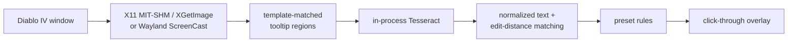

# d4lc

A Linux-native Rust port of
[Diablo4Companion](https://github.com/josdemmers/Diablo4Companion): point at a
Diablo IV item, let local OCR read the tooltip, and get an overlay showing which
properties match your presets. No .NET, Wine, VM, game injection or game-server
traffic.

[](https://github.com/florianaltendorfer/d4lc/actions/workflows/verify.yml)
[](https://github.com/florianaltendorfer/d4lc/actions/workflows/upstream-check.yml)
[](#release-candidate-status)
[](LICENSE)

[](rust-toolchain.toml)
[](Cargo.toml)
[](#packages)
[](#packages)

[](#platform-reality)
[](#platform-reality)
[](#from-pixels-to-markers)
[](https://slint.dev/)

[](#network-and-local-data)
[](#what-it-actually-does)
[](#build-and-run)
[](https://github.com/josdemmers/Diablo4Companion/releases/tag/v5.4.0.0)

> **Upstream shout-out:** d4lc exists because
> [Jos Demmers](https://github.com/josdemmers) built
> [Diablo4Companion](https://github.com/josdemmers/Diablo4Companion). The
> pipeline, affix data, system presets and years of reverse-engineering are his
> work. If this port is useful, please support the original:
> [Ko-fi](https://ko-fi.com/H2H1H5GCR) ·
> [PayPal](https://paypal.me/josdemmers) ·
> [Discord](https://th.gl/discord).

> **Release candidate: `1.0.0-rc.2`, not a stable 1.0 release.** Intended for
> public testing and feedback. X11 is the primary target; Wayland remains
> experimental. See the [validation limits](#release-candidate-status) before use.

## What it actually does

- Captures the Diablo IV window and locates the tooltip under the cursor.
- Runs Tesseract in-process, parses the result, and fuzzy-matches it against
  affix presets.
- Marks affixes, greater and tempered affixes, aspects, uniques, sigils and
  runes in a transparent overlay.
- Keeps Diablo4Companion's settings and preset JSON shapes.
- Imports builds from D2Core, D4Builds, Maxroll, Mobalytics and InfinityBuilds.
- Also ports the trade and paragon overlays.

The deliberate boundary is simple: d4lc reads pixels and draws another window.
It never sends input to Diablo IV and never talks to Blizzard's servers.

## From pixels to markers



System presets supply the resolution- and font-size-specific templates. The
pipeline uses the same data model as the Windows original, but the capture,
window tracking, hotkeys and overlay are native Linux implementations.

## Platform reality

| | X11 | Wayland |
| --- | --- | --- |
| Capture | MIT-SHM, with XGetImage fallback | ScreenCast portal + PipeWire |
| Overlay | SHAPE for click-through input | `zwlr_layer_shell_v1` |
| Game-window tracking | direct X11 | KDE Plasma protocol only |
| Global hotkeys | X11 grabs | GlobalShortcuts portal |
| Status | primary target | experimental |

KDE Plasma and wlroots compositors can provide layer shell. GNOME/Mutter does
not, so the overlay is unavailable there. Missing protocols are reported in the
app rather than replaced with a fake fallback.

The repository contains automated protocol, recorded-frame and Xvfb coverage.
Automated checks do not establish live-game coverage for every feature.
The acceptance checklist is in
[`docs/manual-validation-diablo-iv.md`](docs/manual-validation-diablo-iv.md).
There are intentionally no mock screenshots in this README.

## Release candidate status

`1.0.0-rc.2` is for trying the Linux port and reporting problems, not a claim
that every feature is production-ready:

- Not all character classes, builds, resolutions or game languages have been
  tested in a live game session.
- Trading and the trade overlay have not been validated end to end.
- Rune recognition and data coverage still need live-game validation.
- Wayland has automated protocol coverage, but no live-game acceptance pass.
- Windows has not been tested; this release provides Linux binaries only.
- CI checks recorded and synthetic inputs, GUI interactions and package startup;
  those checks do not replace a fresh live-game acceptance pass for this RC.

Back up existing settings and presets before testing. Report the RC version,
class, game language, resolution and display session with any issue. Review
logs and captures for personal data before sharing them.

## Build and run

Requirements:

- Rust **1.92 or newer** with `rustfmt` and `clippy`
- Clang and `pkg-config`
- X11, fontconfig, Tesseract and Leptonica development libraries
- PipeWire development libraries only when building Wayland capture
- Tesseract language data for every in-game language you enable

Debian / Ubuntu:

```bash
sudo apt install build-essential pkg-config clang libclang-dev \
  libx11-dev libxext-dev libxkbcommon-dev libxkbcommon-x11-0 \
  libfontconfig1-dev libgl1 libegl1 \
  libtesseract-dev libleptonica-dev tesseract-ocr
# Wayland capture only:
sudo apt install libpipewire-0.3-dev
```

Arch Linux:

```bash
sudo pacman -S --needed base-devel pkgconf clang libx11 libxkbcommon-x11 \
  fontconfig tesseract tesseract-data-eng leptonica
# Wayland capture only:
sudo pacman -S --needed libpipewire
```

Build the desktop app:

```bash
git clone https://github.com/florianaltendorfer/d4lc.git
cd d4lc
cargo build --release --locked -p d4lc-app \
  --features "real-runtime leptess-backend"
./target/release/d4lc-app
```

A source build reads game data from `assets/` in the checkout it was built from.
Run it from the repository root. Add `wayland-portal` to the feature list for
Wayland capture. The upstream submodule is needed by parity and release tooling,
not by the compiler.

### First run

1. Open **Settings** and choose the system preset matching the game's resolution,
   HDR mode and font size. Presets can only be changed while the overlay is off.
2. On **Affix**, select the language used by Diablo IV. The matching Tesseract
   language data must be installed.
3. Turn on the overlay. This starts capture and OCR.
4. Optionally enable or rebind hotkeys under **Manage Hotkeys**. Defaults include
   `Ctrl+F12` for the overlay, `Ctrl+F5` for the preset and `Ctrl+F6` for the
   overlay mode.

The app writes its state below `~/.config/d4lc` by default. Override that with
`D4LC_CONFIG_ROOT`. The familiar upstream layout lives below that root:
`Config/`, `Images/`, `Builds/`, `Profiles/` and `logs/`.

## Packages

The release workflow builds an x86_64 tarball, AppImage and Debian package on
Ubuntu 22.04 (glibc 2.35 baseline), plus `SHA256SUMS`. Download the RC assets
from [GitHub Releases](https://github.com/florianaltendorfer/d4lc/releases)
(the entry is marked **Pre-release**). Use the Releases list, not `/releases/latest`,
which excludes release candidates. If the RC assets are not listed, build from
source using the instructions above.

An Arch [`PKGBUILD`](packaging/arch/PKGBUILD) is included for release tags. It
requires the matching public source tag and is not on the AUR.
See [`packaging/README-AUR.md`](packaging/README-AUR.md).

Packaged builds bundle Tesseract, Leptonica and the upstream OCR data. They still
need the host display libraries; the exact runtime contract is recorded by the
packaging and smoke-test scripts.

## Build imports

Build imports are optional and independent of capture/OCR:

| Provider | Fetch path |
| --- | --- |
| Maxroll, InfinityBuilds | plain HTTPS |
| D2Core, D4Builds, Mobalytics | Chrome DevTools Protocol |

The browser-backed providers need an installed Chromium or Google Chrome. d4lc
does not download one and never uses your normal browser profile. Set an exact
binary when auto-discovery is undesirable:

```bash
D4LC_CHROME_BIN=/usr/bin/chromium ./target/release/d4lc-app
```

Each import receives a temporary empty profile and keeps Chromium's sandbox on.
The tested Mobalytics URL forms currently work, but provider markup, APIs and bot
checks can change without notice. Live provider sites are deliberately outside
CI; failures include diagnostics, and **Show browser** is available when a site
requires manual interaction.

## Network and local data

Captures, OCR output, settings and presets are not uploaded. Network access is
limited to these explicit paths:

| Trigger | Destination | Purpose |
| --- | --- | --- |
| 5 seconds after start, then every 16 hours | GitHub API | optional release check |
| startup / explicit preset download | `raw.githubusercontent.com`, GitHub | preset list and archives |
| explicit build import | selected provider | fetch the requested build |
| clicking a link | your default browser | open that link |

The update check follows stable GitHub releases; check the Releases list for
new RCs. Disable the check in Settings or start with `--no-updates`.

Logs stay under the config root; crash logs use
`~/.local/share/d4lc/crashes`; debug captures use `debug-output/`. Captures and
logs may contain BattleTags, character names, other windows or user names in
paths. Inspect them before attaching them to an issue. Report vulnerabilities
through [`SECURITY.md`](SECURITY.md), not a public issue.

Multi-file configuration updates use a journal in `Config/.persistence/`. If a
process dies mid-write, the next start refuses to overwrite the affected files.
Inspect and resolve the record with:

```bash
d4lc-debug config-recover
d4lc-debug config-recover --complete --record <id>   # or --rollback
```

## Debug CLI

Release packages include `d4lc-debug`. From source:

```bash
cargo build --release --locked -p d4lc-cli --bin d4lc \
  --features leptess-backend
```

Useful probes:

```bash
d4lc-debug x11-windows --match "Diablo IV"
d4lc-debug capture-window-raw --match "Diablo IV" --output frame.png
d4lc-debug asset-presets
d4lc-debug settings-report
d4lc-debug live-once --preset 1440p_SMF --language enUS
d4lc-debug live-loop --preset 1440p_SMF --overlay --ocr-worker
```

Game assets resolve from `--root`, then `D4LC_ASSET_ROOT`, then the current
directory. Settings resolve from `--config-root`, then `D4LC_CONFIG_ROOT`, then
the normal config directory. Relative output paths resolve from the current
directory.

## Repository map

| Crates | Job |
| --- | --- |
| `d4lc-capture`, `d4lc-vision`, `d4lc-detect` | pixels in, tooltip regions out |
| `d4lc-ocr`, `d4lc-fuzzy`, `d4lc-parse` | pixels to normalized game text |
| `d4lc-rules`, `d4lc-runtime` | preset evaluation and live orchestration |
| `d4lc-overlay-x11`, `d4lc-overlay-wayland` | platform overlays |
| `d4lc-config`, `d4lc-assets`, `d4lc-core` | persistence, upstream data and shared types |
| `d4lc-gui`, `d4lc-app` | Slint UI and desktop process |
| `d4lc-cli`, `d4lc-debug` | terminal probes and debug artifacts |
| `xtask` | verification and repository maintenance |

The pinned parity target is Diablo4Companion `v5.4.0.0`; the reviewed commit is
recorded in [`upstream.lock`](upstream.lock). Imported assets are hashed in
[`assets/provenance/asset-manifest.json`](assets/provenance/asset-manifest.json).

## Verification

```bash
./scripts/verify_local.sh --fast  # fmt, clippy, tests, dependency direction, parity
./scripts/verify_local.sh         # adds GUI pilots, Xvfb smoke and browser tests
cargo deny check                  # advisories, bans, sources and licenses
```

The full gate expects Xvfb and Chromium/Chrome and should run by itself. CI also
checks the minimum Rust version. Release artifacts are built only after that
commit passes verification, then smoke-tested as packages before a draft release
is created.

Contributions are intentionally scoped around upstream parity; read
[`CONTRIBUTING.md`](CONTRIBUTING.md) before opening a change.

## Origin and licenses

The [upstream wiki](https://github.com/josdemmers/Diablo4Companion/wiki) remains
the best reference for concepts shared with Diablo4Companion.

- d4lc code: [MIT](LICENSE)
- upstream data and presets: MIT, Copyright (c) 2022 Jos Demmers,
  [`licenses/upstream-LICENSE`](licenses/upstream-LICENSE)
- overlay font: Inconsolata Bold, SIL OFL 1.1,
  [`licenses/Inconsolata-OFL.txt`](licenses/Inconsolata-OFL.txt)
- complete provenance:
  [`licenses/license-provenance.json`](licenses/license-provenance.json) and
  [`licenses/upstream-file-manifest.json`](licenses/upstream-file-manifest.json)

Not affiliated with or endorsed by Blizzard Entertainment. Diablo IV is a
trademark of Blizzard Entertainment. Use d4lc in accordance with the game's
terms of service.
