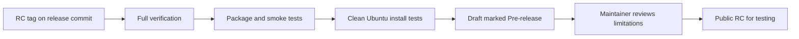

# Linux packaging

`scripts/package_linux_release.sh` is the release staging entrypoint for Linux. The
**Slint desktop app is the primary payload**; CI requires `.deb` and `.AppImage` artifacts.

## Script contract

- Primary payload: `--binary`, default `target/release/d4lc-app` (the Slint desktop
  app, built with `--features "real-runtime leptess-backend wayland-portal"`).
- Debug CLI bundled as `bin/d4lc-debug`: `--debug-binary`, default
  `target/release/d4lc` when the script builds. It is **never** the user-facing primary.
- Unless `--skip-build` is passed, the script builds both binaries itself with those
  feature sets (`cargo build --release --locked`). With `--skip-build` the caller
  builds them and passes both paths.
- Stage a relocatable `d4lc` bundle under `target/package/linux-release/d4lc-<version>/common/d4lc`.
- Copy upstream-derived assets, `assets/provenance/asset-manifest.json`, `licenses/license-provenance.json`, `licenses/upstream-file-manifest.json`, upstream `LICENSE`, `packaging/LICENSE-PROVENANCE-NOTICE.md`, and the embedded overlay font's licence (`licenses/Inconsolata-OFL.txt`, `licenses/bundled-fonts.json`) into the bundle.
- Stage both `deb-root/` and `AppDir/` trees on every run. Build actual `.deb` and `.AppImage` artifacts only when `--deb` or `--appimage` is requested and the host has `dpkg-deb` or `appimagetool`. **In CI both flags are always passed** and the workflow fails loudly if either artifact is missing or `SKIPPED`.
- Wrap the real binaries as `<name>-real` (default `d4lc-real`, `d4lc-debug-real`). The desktop launcher `cd`s into the installed bundle root before exec, so its repo-relative `assets/original/...` lookup works after install. The debug-CLI launcher does **not** change directory: it exports `D4LC_ASSET_ROOT=<bundle root>` (read-only game data) and keeps the caller's working directory, so relative outputs and the default `debug-output/` land where the user runs it and nothing is written into the bundle. The tarball carries the same launchers as `bin/d4lc` and `bin/d4lc-debug`, so an extracted tarball runs from any directory.
- Copy `upstream.lock` into the bundle root (read by `d4lc-debug upstream-changed`). The other `upstream-*` commands need a source checkout and fail with "requires a developer checkout" in a package.
- Copy the canonical `.desktop` file from `crates/d4lc-app/assets/d4lc.desktop` (or `$D4LC_DESKTOP_FILE`) and rewrite `Exec=` to the primary launcher name. The desktop file uses `Terminal=false` because the desktop app is a GUI.
- Bundle tessdata only when `--tessdata-dir /path/to/tessdata` is passed. Otherwise the packaged binary uses system Tesseract data.

## Installed layout (`.deb`)

| Path | Purpose |
|---|---|
| `/opt/d4lc/bin/d4lc-real` | Real desktop app binary (renamed copy of `d4lc-app`) |
| `/opt/d4lc/bin/d4lc-debug-real` | Real debug CLI binary, only when `--debug-binary` is passed |
| `/opt/d4lc/assets/original/...` | Upstream-derived game data and presets |
| `/opt/d4lc/assets/d4lc/...` | d4lc-authored preset supplements (marker templates upstream lacks; provenance in `assets/d4lc/README.md`) |
| `/opt/d4lc/docs/...` | License, provenance, runbooks, runtime requirements, build metadata, `ldd` output |
| `/opt/d4lc/tessdata/...` | Bundled tessdata, only when `--tessdata-dir` is passed |
| `/usr/bin/d4lc` | Wrapper that sets `TESSDATA_PREFIX`, `cd`s into `/opt/d4lc`, and execs `d4lc-real` |
| `/usr/bin/d4lc-debug` | Wrapper that sets `D4LC_ASSET_ROOT=/opt/d4lc` (no `cd`) and execs `d4lc-debug-real`, only when `--debug-binary` is passed |
| `/usr/share/doc/d4lc` | Symlink to `/opt/d4lc/docs` |
| `/usr/share/applications/d4lc.desktop` | Copied from `crates/d4lc-app/assets/d4lc.desktop` |
| `/usr/share/icons/hicolor/256x256/apps/d4lc.png` | Bundled app icon (256x256 PNG from `crates/d4lc-app/assets/d4lc.png`) |

## AppDir layout (AppImage)

| Path | Purpose |
|---|---|
| `AppRun` | Generated wrapper that execs `usr/bin/d4lc`, or `usr/bin/d4lc-debug` when the first argument is `--debug-cli` |
| `usr/bin/d4lc-debug` | Generated debug-CLI wrapper (`D4LC_ASSET_ROOT=usr/lib/d4lc`, no `cd`), only when `--debug-binary` is passed |
| `usr/bin/d4lc` | Generated wrapper (same logic as the `.deb` wrapper, but with `appdir`-relative paths) |
| `usr/lib/d4lc/` | The relocatable bundle (same as `/opt/d4lc` in the `.deb`) |
| `usr/share/applications/d4lc.desktop` | Desktop entry inside the AppImage |
| `usr/share/icons/hicolor/256x256/apps/d4lc.png` | AppImage icon (hicolor entry) |
| `d4lc.png` / `.DirIcon` | AppDir-root icon; `.DirIcon` symlinks to it per AppImage convention |
| `d4lc.desktop` | Top-level desktop-entry copy for the AppImage runtime |

## Typical commands

```bash
# Desktop app as the primary binary, with the debug CLI bundled
./scripts/package_linux_release.sh \
    --skip-build \
    --binary target/release/d4lc-app \
    --debug-binary target/release/d4lc \
    --deb --appimage

# Legacy CLI-only flow (still supported for debug workflows)
./scripts/package_linux_release.sh --skip-build --binary target/release/d4lc --deb --appimage

# Local tarball-only build
./scripts/package_linux_release.sh
```

## Runtime requirements

- The tray ships in release builds: `tray-icon` is a default feature of
  `d4lc-app`, so the workflow build (`--features "real-runtime
  leptess-backend wayland-portal"`) includes the `ksni` tray with the
  tooltip "Diablo IV Companion". A second launch of the packaged binary
  focuses the running window instead of starting a duplicate instance
  (single-instance guard).
- OCR is compiled through `leptess-backend`; build hosts need `pkg-config`, `libtesseract-dev`, and `libleptonica-dev` or distro-equivalent development packages.
- Tesseract, Leptonica and their image-codec libraries are bundled under `lib/`. Runtime hosts provide glibc, libstdc++/libgcc_s, the X11 client libraries, fontconfig/freetype, libcurl/OpenSSL, zlib and PipeWire; the `.deb` declares these as dependencies. Libraries tied to the host (PipeWire/SPA, D-Bus, systemd, GL/Vulkan, Wayland, the C++ runtime) are never bundled.
- Tessdata for every OCR language you intend to use must be installed on the host unless the release was built with `--tessdata-dir`.
- RC versions keep their SemVer identity in filenames and build metadata
  (`1.0.0-rc.1`); Debian's control field uses `1.0.0~rc.1` so a later stable
  `1.0.0` is an upgrade, not a downgrade.
- Capture and overlay are X11-first. Release smoke tests and supported packaging targets assume a real X11 session with `DISPLAY` set.
- The release artifacts bundle no browser. The `.deb` recommends `xdg-utils` and suggests `chromium | chromium-browser`; the Arch package lists Chromium as an optional dependency. Only the D2Core, D4Builds and Mobalytics build imports drive a headless Chromium/Chrome (the `D4LC_CHROME_BIN` binary, else the installed one); capture, OCR and the overlay never need it. Links open through `xdg-open`.
- X11 server support:
  - MIT-SHM enables the preferred capture path; XGetImage is the fallback
  - SHAPE provides click-through input for the native overlay
- Wayland capture is compiled into the release build via `wayland-portal` (ScreenCast portal + PipeWire): build hosts need `libpipewire-0.3-dev`, runtime hosts need `xdg-desktop-portal` with a PipeWire backend. Capture and overlay remain X11-first: X11 is the platform that was validated in a live Diablo IV session (on an earlier version; the current code still needs that check), release smoke tests sign off on X11/Xvfb, and Wayland capture is validated with automated tests only; a live Wayland session test is still pending. XWayland may still launch the process on Wayland-only hosts.

## Release workflow

`.github/workflows/release.yml` builds the desktop app + debug CLI and
produces the tarball, `.deb`, and `.AppImage` artifacts in one job. The job
runs in an `ubuntu:22.04` container pinned by digest (the glibc 2.35
baseline) with a pinned Rust toolchain. Tesseract 5 and newer PipeWire
headers come from two PPAs whose signing-key fingerprints the job checks;
`appimagetool` and the AppImage runtime are pinned by version and SHA-256. The
job builds `d4lc-app` with `--features "real-runtime leptess-backend
wayland-portal"` and `d4lc-cli` with `leptess-backend`, runs
`scripts/package_linux_release.sh --skip-build --binary
target/release/d4lc-app --debug-binary target/release/d4lc --deb --appimage`,
records the toolchain, tool and system-package versions in
`docs/build-environment.txt`, then runs `scripts/smoke_release_artifacts.sh`
under `xvfb-run` against the produced artifacts.

The job hard-fails if either `deb_artifact` or `appimage_artifact` is
`SKIPPED` or missing from disk.

### Triggers

- Tag push matching `v*.*.*`: create or update a **draft** GitHub Release
  with the tarball, `.deb`, `.AppImage`, `SHA256SUMS`, and
  `package-summary.txt`. The draft job runs only after the packaging job
  (including the smoke gate) and the `.deb` install test passed, so a
  failed check leaves no draft. Manual finalization remains a separate
  approval.
- `workflow_dispatch` with `preflight=true` (default): upload artifacts via
  `actions/upload-artifact` only, no GitHub Release mutation.
- `workflow_dispatch` with `preflight=false`: same as the tag path. The tag
  is derived from the built package version, including when the optional
  version override is empty.

Versions with a prerelease suffix (for example `1.0.0-rc.1`) create or refresh
a draft marked **Pre-release**, never **Latest**. Publishing the reviewed RC
draft is a separate maintainer action. Public testers can use the RC without
implying stable-release acceptance; list untested classes, trading, runes and
platforms in the notes. A stable release still needs the live acceptance check.



For `1.0.0-rc.1`, commit the verified changes, push `main`, then push tag
`v1.0.0-rc.1` on that same commit. Alternatively, start the release workflow on
that commit with `preflight=false` after the tag exists. Review the resulting
draft's assets and limitations, then publish it with **Pre-release** still
checked. Do not mark it **Latest** or create a `v1.0.0` tag for this RC.

### Smoke gate

`scripts/smoke_release_artifacts.sh` launches each detected artifact through
its packaged launcher wrapper under `xvfb-run` with a bounded timeout and
per-run config and runtime directories, captures per-artifact logs and an X11
screenshot, and writes a `smoke-results.txt` summary under
`debug-output/release-smoke/`. A launch passes only when the app was still
running when the timeout fired (exit status 124) and its log carries every
startup line listed in `scripts/startup_markers.sh` (single-instance guard,
tray init, hotkey wiring, window observer); a panic or an early exit fails
it. The script hard-fails if any detected launch fails or no artifact
launches successfully.

### Install gate

The `install-test-deb` job installs the `.deb` through `apt` in clean
Ubuntu 22.04 and 24.04 containers with `scripts/smoke_deb_install.sh`. The
containers have no D-Bus session bus, so the test also asserts the expected
degradation: no tray icon and the logged single-instance fallback.

## Output layout

Every run writes under `target/package/linux-release/d4lc-<version>/`:

- `common/d4lc/`: relocatable bundle with `bin/d4lc-real`, `bin/d4lc-debug-real` (when `--debug-binary` is set), assets, docs, and optional tessdata
- `deb-root/`: Debian package root with `/opt/d4lc`, `/usr/bin/d4lc`, `/usr/bin/d4lc-debug` (optional), and `/usr/share/applications/d4lc.desktop`
- `AppDir/`: AppImage root with `AppRun`, `usr/bin/d4lc`, `usr/lib/d4lc/...`, desktop entry, icon, and bundled payload
- `artifacts/`: always contains a tarball, `SHA256SUMS`, and `package-summary.txt`; contains `.deb` and `.AppImage` only when `--deb`/`--appimage` is requested and the toolchain is available. In CI both flags are always passed and both artifacts are required.

## Provenance path

The packaged notice path is `docs/LICENSE-PROVENANCE-NOTICE.md` inside the staged bundle. That note points back to:

- `docs/license-provenance.json`
- `docs/asset-manifest.json`
- `docs/upstream-LICENSE`

The d4lc licence (MIT) ships as `docs/LICENSE`, copied from the repository's root `LICENSE`.

The embedded Inconsolata overlay font (SIL OFL 1.1) additionally ships `docs/Inconsolata-OFL.txt` and `docs/bundled-fonts.json`, copied from `licenses/Inconsolata-OFL.txt` and `licenses/bundled-fonts.json`.

Those files are copied from:

- `licenses/license-provenance.json`
- `assets/provenance/asset-manifest.json`
- `upstream/Diablo4Companion/LICENSE`

## Smoke test

The CI smoke is `scripts/smoke_release_artifacts.sh`: it starts every built
artifact under Xvfb and fails the release when none starts.
